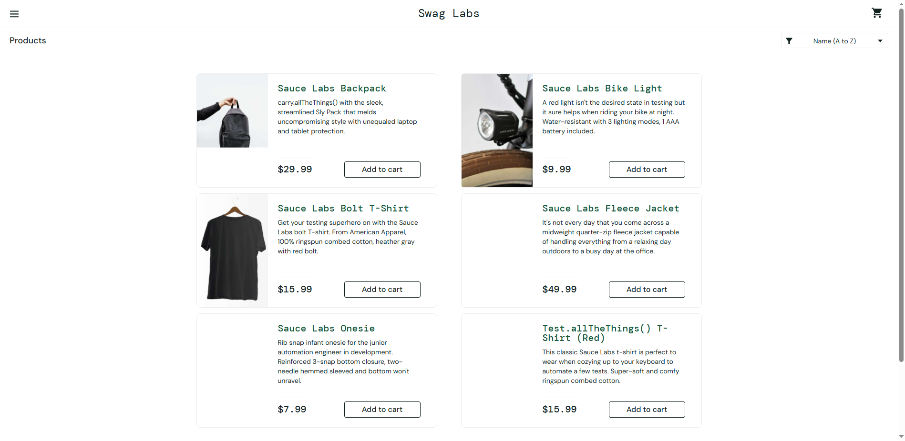

# AI Selenium Automation

[](https://github.com/shiyashalmali/AI-Selenium-Automation/actions/workflows/maven.yml)

A Java 17 and Selenium WebDriver test framework for automating the public [SauceDemo](https://www.saucedemo.com/) storefront. It uses TestNG, the Page Object Model, explicit waits, Allure reporting, and GitHub Actions to exercise login, inventory, cart, and checkout behavior.

## Technology stack

- Java 17
- Selenium WebDriver 4
- TestNG
- Maven
- Allure TestNG and Allure Maven
- Chrome and Microsoft Edge (headless execution)
- GitHub Actions and GitHub Pages

## Framework architecture

Page objects own page-specific locators and actions; tests describe user-visible scenarios and assert their outcomes. `BaseTest` creates a fresh browser for each test and closes it afterward. The TestNG listener captures failed-test screenshots, saves them locally, and attaches them to Allure results.

```text
.
├── .github/workflows/maven.yml
├── docs/images/inventory.png
├── src/test
│   ├── java
│   │   ├── base/BaseTest.java
│   │   ├── listeners/TestListener.java
│   │   ├── pages
│   │   │   ├── CartPage.java
│   │   │   ├── CheckoutPage.java
│   │   │   ├── InventoryPage.java
│   │   │   └── LoginPage.java
│   │   └── tests/SauceDemoTest.java
│   └── resources/allure.properties
├── testng.xml
└── pom.xml
```

### Page Object Model

`LoginPage`, `InventoryPage`, `CartPage`, and `CheckoutPage` encapsulate their respective page interactions and stable application locators. `SauceDemoTest` uses those page objects to keep business flows separate from Selenium mechanics. `BaseTest` centralizes browser configuration, headless options, and test-level setup and cleanup.

Failure screenshots are captured automatically through a TestNG `ITestListener` implementation in `onTestFailure`; it obtains the test's driver through `BaseTest.getDriver()` and attaches the image to Allure.

## Test coverage

The suite executes **23 independent test cases**, including DataProvider cases:

| Area | Scenarios |
|---|---|
| Login (6) | Successful login; invalid username; invalid password; locked-out user; empty username; empty password |
| Inventory (6) | Inventory title and six-product count; catalog names and prices; A–Z, Z–A, price low-to-high, and price high-to-low sorting |
| Cart (6) | Add one product; add multiple products; badge count; product names, prices, and quantities; remove a product while retaining another; verify a new cart is empty |
| Checkout (5) | End-to-end purchase and confirmation; required first name, last name, and postal code (three independent cases); item subtotal, tax, and grand total |

Tests create a fresh browser session and start from the login page, so their results do not depend on execution order or shared cart state. SauceDemo does not provide product-category filtering, and this framework does not simulate it.

## Browser support

Chrome is the default browser. Choose Chrome or Edge with the `browser` system property:

```powershell
mvn -B clean test -Dbrowser=chrome
mvn -B clean test -Dbrowser=edge
```

Both browser configurations use headless mode, including local runs. Selenium Manager resolves the browser driver; install a compatible browser on the machine running the suite.

## Local setup

Prerequisites: JDK 17, Maven 3.9.x, and Chrome or Edge.

```bash
git clone https://github.com/shiyashalmali/AI-Selenium-Automation.git
cd AI-Selenium-Automation
mvn -B clean test
```

Run one test method:

```bash
mvn -Dtest=SauceDemoTest#invalidUsernameIsRejected test
```

Run the checkout validation cases by method:

```bash
mvn -Dtest=SauceDemoTest#checkoutRequiresMandatoryInformation test
```

Test reports and runtime screenshots are written under ignored build/output directories and are not committed.

## Allure reports

The Maven test run writes Allure result files to `target/allure-results`. Generate the HTML report after running tests:

```bash
mvn -B allure:report
```

Open `target/site/allure-maven-plugin/index.html` in a browser. The report includes failure screenshots when a test fails. CI uploads both the results and generated HTML report as workflow artifacts.

## GitHub Actions and live report

The workflow runs on pushes and pull requests targeting `master`, and on manual dispatch. It uses Java 17, Maven dependency caching, and `mvn -B clean test`. It generates and uploads Allure results and the HTML report even if tests fail; the test job remains failed so failures are not hidden.

The latest published report is intended to be available at **[GitHub Pages Allure report](https://shiyashalmali.github.io/AI-Selenium-Automation/)**. Pages deployment runs only for `master`, never for pull requests.

**One-time repository setup:** In the repository's **Settings → Pages**, set the build and deployment source to **GitHub Actions**. The workflow supplies the required Pages and OIDC deployment permissions.

## Screenshot

The repository includes an existing SauceDemo inventory screenshot:



## Scope and limitations

- This is a UI regression suite for the public SauceDemo application, not a production storefront.
- It covers login, inventory sorting and display, cart operations, and checkout; it does not cover APIs, databases, payment processing, or native category filters.
- The GitHub Actions workflow runs the default Chrome configuration. Edge is configurable for local runs but is not separately exercised in CI.
- The hosted Allure report is updated only by a successful report-generation step on `master`; access to GitHub Pages must be enabled once in repository settings.

## Repository metadata

- **Description:** Java Selenium automation framework using TestNG, Page Object Model, Allure reporting and GitHub Actions CI.
- **Topics:** `selenium`, `java`, `testng`, `maven`, `page-object-model`
